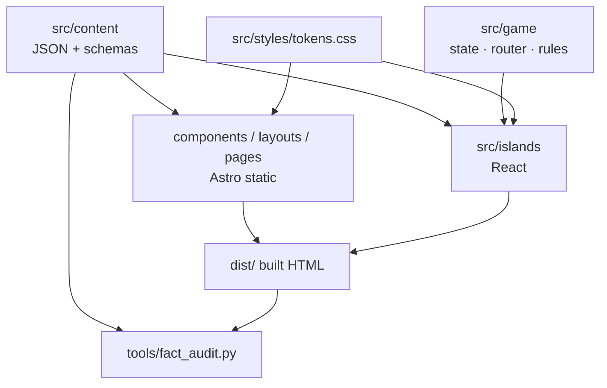
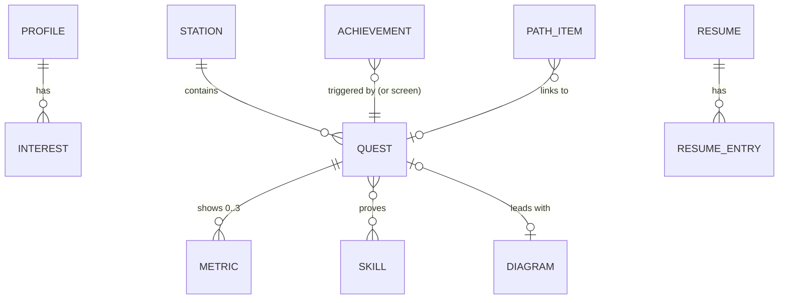
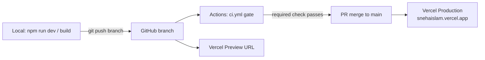

# Architecture Spine: The Fab Line

## Design Paradigm

**Islands architecture.** Astro pre-renders one static page containing **all** content as semantic HTML, which is the Recruiter Mode baseline. React **islands** hydrate on top to add the game. Islands enhance, they never own content.

| Layer | Directory | Owns |
|---|---|---|
| Content | `src/content/` | Every fact, string and metric (JSON + zod schemas) |
| Static presentation | `src/components/`, `src/layouts/`, `src/pages/` | Markup for every section and Level Card (Astro, zero JS) |
| Game logic | `src/game/` | State store, router, achievement rules (TS, framework-free) |
| Islands | `src/islands/` | HUD, Track controller, Inspect drawer, sheets, toasts, sprite (React) |
| Styles | `src/styles/` | DESIGN.md tokens as CSS custom properties |
| Build tools | `tools/` | Python fact audit and image pipeline (stdlib only) |



Arrows point from dependency to dependent. Nothing depends on `src/islands`. `src/game` imports nothing from `src/islands`, `src/components` or React.

## Invariants & Rules

### AD-1: All content is in the pre-rendered HTML [ADOPTED]
- **Binds:** FR-25, FR-27, NFR-9, NFR-12
- **Prevents:** content that exists only after JS runs (invisible to recruiters on slow phones, screen readers and link previews)
- **Rule:** Every fact, Caption, Character Line, metric, link and diagram text is emitted by an Astro component at build time. An island may move, reveal or re-display existing content, but nothing may appear *only* inside an island's client-side render.

### AD-2: One content source, schema-validated
- **Binds:** FR-31, FR-30, all content FRs
- **Prevents:** Game Mode, Recruiter Mode and the fact audit drifting apart, and copy hard-coded in components
- **Rule:** All content lives in `src/content/*.json` and is validated by zod schemas in `src/content.config.ts`. Components and islands receive content only through Astro content collections, or as props derived from them. UI chrome strings ("Résumé", "Inspect ▸", "Copy link") live only in `src/content/ui.json`. A build fails on schema errors.

### AD-3: Stable slugs are the only identifiers
- **Binds:** FR-8, FR-16, FR-22, FR-28, FR-29
- **Prevents:** two units naming the same Station or Quest differently, which breaks deep links, achievements and the Quest Log
- **Rule:**
  - **Station slugs:** exactly `ai`, `power`, `compiler`, `cleanroom`, plus screen slugs `character`, `speedrun`, `dock`, `quantum`.
  - **Item slugs:** kebab-case, unique per Station, defined once in the content entry.
  - **Derived from the slug:** the DOM `id` is `<station>/<item>` (Station: `<station>`), and the URL hash is `#<station>/<item>`.
  - **References:** achievements, skills and Quest Log rows refer to Quests only by `"<station>/<item>"`.

### AD-4: Modes differ only by attribute, never by markup tree
- **Binds:** FR-25, FR-26, FR-27, NFR-7
- **Prevents:** a second "recruiter" page or component tree drifting from the game one
- **Rule:**
  - **One page (`/`).** `<html data-mode="recruiter|game" data-motion="on|off">`. The markup ships `data-mode="recruiter"`.
  - **A blocking inline script in `<head>`** sets the real mode before paint. The priority order is `?mode=` → localStorage → `game`. Motion is set from localStorage → `prefers-reduced-motion`.
  - **Styling:** CSS selects on these attributes. Islands render nothing while `data-mode="recruiter"`.

### AD-5: `src/game/state.ts` is the sole mutator of game state
- **Binds:** FR-7, FR-18, FR-22, FR-24, FR-26
- **Prevents:** two islands tracking visits or achievements separately, and storage written from many places
- **Rule:**
  - **The store:** one nanostores module holds `mode`, `motion`, `currentStation`, `visitedStations`, `viewedQuests`, `unlockedAchievements` and `openOverlay`. Islands read through `@nanostores/react` and change state only by calling exported actions.
  - **Persistence:** goes through one adapter wrapped in try/catch. Preferences (`mode`, `motion`) use `localStorage`. Progress uses `sessionStorage` *[ASSUMPTION per PRD FR-7]*.
  - **Achievement rules:** live in `src/game/achievements.ts` as data (`trigger: "<station>/<item>" | screen slug`), never inside islands.
  - **Viewport observation:** only `islands/TrackController.tsx` observes it (one `IntersectionObserver`, 50% threshold) and calls `markVisited` / `markViewed`. No other island decides what has been seen.

### AD-6: `src/game/router.ts` is the sole writer of the URL
- **Binds:** FR-8, FR-28, FR-29
- **Prevents:** competing `history`/`hash` writes and broken back-button behaviour
- **Rule:** Only the router calls `history.replaceState`, `history.pushState` or sets `location.hash`. Scroll-driven Station changes use `replaceState`. Opening Inspect uses `pushState`, so Back closes it. Without JS, native `#id` anchors (AD-3) still scroll to the target.

### AD-7: One motion switch gates every animation
- **Binds:** NFR-7, FR-24, UX §9
- **Prevents:** an animation that ignores reduced motion
- **Rule:** CSS animations and transitions are declared only under `[data-motion="on"]`. JS-driven motion (scroll-linked sprite, count-ups) checks `state.motion` first. Durations: UI ≤300 ms, scene ≤1 s (UX §9).

### AD-8: Tokens only, from DESIGN.md
- **Binds:** NFR-8, DESIGN.md
- **Prevents:** hard-coded colours drifting from the AA-checked palette
- **Rule:**
  - **Colour:** `src/styles/tokens.css` is the only file containing colour hex values. It mirrors DESIGN.md frontmatter names (`--grass`, `--gold`, `--panel` …). Components and SVGs use `var(--token)` or `currentColor`.
  - **Text:** never `--dirt` or `--stone`.
  - **Changes:** a new colour means a DESIGN.md change first.

### AD-9: JS is opt-in per island and budgeted
- **Binds:** NFR-2, NFR-3
- **Prevents:** a framework-heavy bundle and LCP regressions
- **Rule:**
  - **Hydration:** only the HUD uses `client:load`. The other islands use `client:idle` or `client:visible`.
  - **Budget:** total shipped JS is ≤100 KB gzip and first-load transfer is ≤600 KB. Both are enforced by Lighthouse CI budgets.
  - **Dependencies:** a new runtime dependency is allowed only if the budget still passes.
  - **Engines:** no canvas or game engine. Rendering is DOM + SVG + CSS.

### AD-10: Nothing reaches `main` without the gate [ADOPTED: Vercel deploys `main`]
- **Binds:** FR-30, NFR-1, SM-4, SM-5
- **Prevents:** an invented fact or a perf/a11y regression going live
- **Rule:**
  - **The check:** GitHub Actions workflow `ci.yml` runs on every pull request: `astro check` → `vitest run` → `astro build` → `python tools/fact_audit.py` → `linkinator dist` → `lhci autorun` (static `dist/`, performance and accessibility ≥0.9, plus budgets).
  - **Branch protection:** `main` requires this check. All changes reach `main` by PR, never by direct push. Vercel previews every PR and deploys `main`.

### AD-11: Fact audit contract
- **Binds:** FR-30, D3, D8, D10
- **Prevents:** numbers or names that aren't in the inventory reaching the page
- **Rule:**
  - **The tool:** `tools/fact_audit.py` uses Python ≥3.12 and the standard library only.
  - **What it checks:**
    - every numeric token and every Character Line / Caption in `src/content/*.json` **and** in the visible text of `dist/index.html` (text nodes plus `alt`/`aria-label`/`<title>`/`<desc>`; `<script>`, `<style>` and other attributes excluded) must appear in `docs/content-inventory.md` or `legacy/index.html`
    - the banned list must be absent: teammate names, "built" / "tested" / "working device" within the capstone entry, planned course codes, "Engineering Ambassador" outside the résumé entry
  - **Failure:** it exits non-zero and lists each offending string and file.
  - **Exceptions:** an allow-list file `tools/fact_audit_allow.txt` holds approved non-fact strings (UI chrome). Each entry needs a comment.

### AD-12: Static assets have one home and one producer
- **Binds:** D1, D2, D13, NFR-4
- **Prevents:** duplicate or unoptimised images and a moved résumé URL
- **Rule:**
  - **Location:** everything served as-is lives in `public/`. The résumé stays at `/Sneha_Islam_Resume.pdf`, and character art is at `/assets/character/*`.
  - **Producer:** `tools/images.py` is the only producer of character derivatives (WebP crops, the sprite sheet, the OG image).
  - **Markup:** every `` declares `width` and `height`, and below-the-fold images use `loading="lazy"`.

### AD-13: Analytics is one component in one place [ADOPTED: D12]
- **Binds:** NFR-10, D12
- **Prevents:** extra trackers and cookies
- **Rule:** `<Analytics />` from `@vercel/analytics/astro` appears only in `src/layouts/Base.astro`. No other analytics, tracking or third-party scripts.

## Consistency Conventions

| Concern | Convention |
|---|---|
| **Files** | Astro components `PascalCase.astro`; islands `PascalCase.tsx`; game modules `camelCase.ts`; content `kebab-case.json` |
| **Content numbers** | Stored as the **display string exactly as the source** (`"1,200+"`, `"<300 ms"`, `"≈8.2 mAh"`), with an optional `qualifier` (`"simulated"`, `"estimate"`, `"projected"`). Never re-format numbers in code. |
| **Dates** | `"YYYY-MM"` for sorting, plus a `display` string as written on the site (`"FEB 2026 – MAY 2026"`) |
| **Status** | `"done" \| "active" \| "next"`; side quests have `side: true` |
| **Diagrams** | `src/components/diagrams/<Name>.astro`, inline SVG with `role="img"`. `<title>` and `<desc>` come from the content entry's `diagram.title` and `diagram.alt`. |
| **Overlays** | One at a time (`state.openOverlay`). Focus trap + Esc + focus restore, via one shared `useOverlay` hook. |
| **Storage keys** | Prefixed `fabline:` (`fabline:mode`, `fabline:motion`, `fabline:progress`) |
| **Errors** | Islands are wrapped in an error boundary that renders `null`, so the static content stays (NFR-12). No `console.error` noise in production. |
| **Tests** | `src/game/*.test.ts` with Vitest for state, router and achievement rules; `tools/test_*.py` for the audit |

## Stack

| Name | Version |
|---|---|
| Node.js (local + Vercel build) | 26.x |
| npm | 11.x |
| Astro | 7.4.x |
| @astrojs/react | 7.1.x |
| React / React DOM | 19.3.x |
| TypeScript | 6.0.3 |
| @astrojs/check | 0.9.x |
| nanostores / @nanostores/react | 1.5.x / 2.0.x |
| @vercel/analytics | 2.0.x |
| Vitest | 5.1.x |
| @lhci/cli | 0.16.x |
| linkinator | 8.1.x |
| Python (CI tools, stdlib only) | ≥3.12 |
| CI | GitHub Actions |
| Hosting | Vercel (static output, Astro preset) |

## Structural Seed

```text
portfolio/
  .github/workflows/ci.yml        # AD-10 gate
  legacy/index.html               # frozen copy of the old site (audit reference)
  docs/content-inventory.md       # fact source (D1–D14)
  public/
    Sneha_Islam_Resume.pdf
    assets/character/             # WebP portraits, avatar, sprite sheet (from tools/images.py)
  src/
    content.config.ts             # zod schemas for every collection
    content/                      # profile, stations, quests, skills, path, achievements, resume, early-work, ui (JSON)
    styles/tokens.css             # DESIGN.md tokens
    layouts/Base.astro            # <head>, mode script, Analytics
    pages/index.astro             # the one page
    components/                   # Title, CharacterCard, Station, LevelCard, ResumeSheet, … (static)
      diagrams/                   # inline SVG diagram components
    game/                         # state.ts, router.ts, achievements.ts, storage.ts (+ tests)
    islands/                      # Hud, TrackController, InspectDrawer, SkillTree, QuestLog, Toasts, Sprite
  tools/
    fact_audit.py · fact_audit_allow.txt · images.py · test_fact_audit.py
  lighthouserc.json               # budgets: JS ≤100 KB gz, total ≤600 KB, perf/a11y ≥0.9
  astro.config.mjs · package.json (engines.node 26.x) · tsconfig.json
```

**Content model:**



**Deployment and environments:**



There are two environments, Preview (per PR) and Production (`main`). There are no secrets, environment variables, servers or databases.

## Capability → Architecture Map

| Capability / area | Lives in | Governed by |
|---|---|---|
| Title, Character Card, Stations, Level Cards, Dock, Quantum Fab (FR-1…FR-12, FR-19…FR-21) | `src/components/*` | AD-1, AD-2, AD-3 |
| Inspect L1–L3, easter eggs (FR-13, FR-14) | `LevelCard.astro` (content) + `islands/InspectDrawer.tsx` (reveal) | AD-1, AD-5, AD-6 |
| Skill Tree, Quest Log, XP (FR-15…FR-18) | `islands/SkillTree.tsx`, `islands/QuestLog.tsx`, `game/state.ts` | AD-2, AD-3, AD-5 |
| Achievements (FR-22) | `game/achievements.ts` + `islands/Toasts.tsx` | AD-5, AD-7 |
| HUD, Mini-map, motion toggle (FR-23, FR-24, FR-7, FR-8) | `islands/Hud.tsx` (static fallback nav in `Base.astro`) | AD-4, AD-5, AD-6, AD-7 |
| Recruiter Mode, no-JS (FR-25…FR-27) | `Base.astro` mode script + CSS | AD-1, AD-4 |
| Deep links, copy link (FR-28, FR-29) | `game/router.ts` | AD-3, AD-6 |
| Fact Audit, single source (FR-30, FR-31) | `tools/fact_audit.py`, `src/content/` | AD-2, AD-10, AD-11 |
| Performance, assets, a11y, analytics (NFR-2…NFR-10) | `lighthouserc.json`, `public/`, `tokens.css`, `Base.astro` | AD-8, AD-9, AD-12, AD-13 |

## Deferred

- **Swapping React for Preact (`@preact/compat`).** Only if the 100 KB JS budget can't be met with React 19.
- **Browser end-to-end tests (Playwright).** Add after M3, when there are enough interactions to justify them. Lighthouse, linkinator, Vitest and the audit cover M1–M2.
- **OG image generation details.** `tools/images.py` will produce it; the exact crop is decided in the M2 story.
- **Sprite animation technique** (CSS `steps()` on a sheet vs frame swap in React). Decided when Sneha delivers the art (D13).
- **Custom domain.** It stays on `snehaislam.vercel.app` until Sneha decides otherwise.
- **i18n, CMS, service worker or offline mode.** Out of scope per PRD §7.
