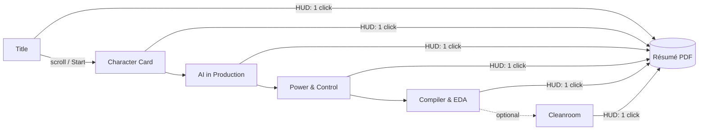
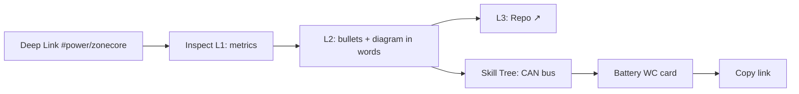
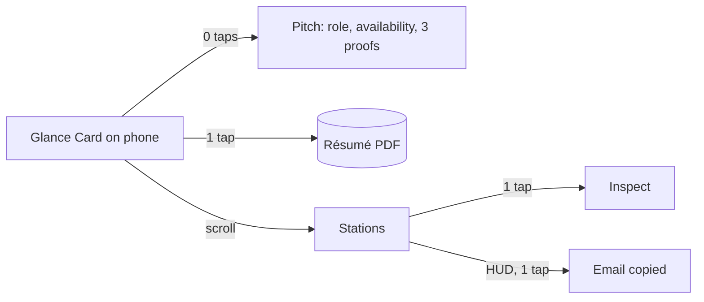

# The Fab Line: Experience Spine

**How this fits with the other files:**
- Visual tokens live in `DESIGN.md` and are referenced here as `{path.to.token}`.
- Wireframes are in [`wireframes/wireframes.md`](wireframes/wireframes.md).
- If a wireframe and this spine disagree, the spine wins.

> **Change D15 (2026-11-25, Sneha):** there is no Recruiter Mode and no Game Mode. It is **one view with progressive depth**: the Glance Card (0 clicks) → scroll the Stations (0 clicks) → Inspect (1 click), with the Résumé PDF 1 click from everywhere. The static page without JS is the baseline, not a mode. Spines win; anything below that still mentions modes is superseded.

## 1. Foundation
- **Form factor:** a single-surface responsive web page that works from 360 px to wide desktop.
- **Input:** mouse, touch and keyboard all have full parity.
- **One view, progressive depth (D15):** Glance Card → scroll → Inspect. The same pre-rendered page is the **static baseline** before JavaScript loads or if it fails (FR-27); there is no mode switch.
- **UI system:** none inherited. The current site's tokens are extended in `DESIGN.md`.
- **Stack constraints that shape UX** (D9): React + TypeScript pre-rendered to static HTML, so every word on screen exists in the HTML before any script runs.

## 2. Information architecture
The Track is a single vertical page. Every screen is a full-viewport section in this order:

| # | Surface | Deep Link | Purpose | Reached from |
|---|---|---|---|---|
| 1 | Title Screen | `#` | Who she is, in 3 seconds | Page load |
| 2 | Character Card | `#character` | Role fit: degree, availability, home, equipment | Start · scroll · Mini-map |
| 3 | Station: AI in Production | `#ai` | Shipped software and AI | scroll · Mini-map |
| 4 | Station: Power & Control | `#power` | Embedded and controls | scroll · Mini-map |
| 5 | Station: Compiler & EDA | `#compiler` | Systems depth | scroll · Mini-map |
| 6 | Station: Cleanroom | `#cleanroom` | Fabrication and the Main Quest | scroll · Mini-map |
| 7 | Speedrun Banner | `#speedrun` | 8 repos, Nov 2026 | scroll |
| 8 | Shipping Dock | `#dock` | Quest Log, Résumé, contact | scroll · Mini-map · HUD |
| 9 | Quantum Fab | `#quantum` | Locked dream | scroll · Mini-map |

**Overlays,** one at a time and never stacked:
- **Inspect drawer:** a side panel on desktop, a bottom sheet on mobile.
- **Skill Tree sheet** (`#skills`).
- **Quest Log sheet** (`#quests`).
- **"More" menu.**

**Level Card Deep Links:** `#<station>/<item>`, for example `#ai/communitech` or `#cleanroom/capstone` (FR-28).

**Surface closure:**

| Need (PRD) | Surface that delivers it | Journey that lands there |
|---|---|---|
| Role fit | Character Card | F1 |
| Top achievements | Stations 3–5 L0 | F1 |
| Résumé | HUD (every screen) + Shipping Dock | F1, F3 |
| Contact | HUD (every screen) + Shipping Dock | F1, F3 |
| Project depth | Inspect | F2 |
| Repos / diagrams / metrics | Level Card + Inspect L3 | F2 |
| Fast skim | Glance Card (availability + 3 Proof Tiles + Résumé) | F1, F3 |

## 3. Voice and tone
Sneha speaks in the first person: **confident, warm, nerdy, concise**. UI chrome speaks plainly. **No in-fiction labels on escape hatches.** "Résumé" stays "Résumé", never "Inventory scroll".

| Do | Don't |
|---|---|
| "I routed 2,218 blocks on a 54×54 FPGA." | "Behold my mighty FPGA skills!!" |
| "Achievement: Shipped to production" | "Epic win unlocked! 🎉🎉" |
| "Not unlocked yet. That's the long-term goal." | "Coming soon™" |
| "Résumé" · "▶ Start" · "Inspect ▸" | "Skip boring stuff" / "Normie mode" |
| "Design proposal ✓ · Build Sep 2027" | "Capstone: done!" |
| Qualifier next to the number: "+14.1% saves · simulated" | A footnote that says "*simulated" |

## 4. Word budgets
These are hard caps. The Fact Audit (FR-30) can enforce them as warnings. Numbers and units count as one word.

| Surface | Visible words | What counts | Behind Inspect |
|---|---|---|---|
| Glance Card (Title Screen) | **≤30** | name + class + tagline + availability + 3 Proof Tile numbers and labels (button and HUD labels excluded) | — |
| Character Card | ≤35 | values only; field labels excluded | Training (coursework) expands |
| Station header | **≤20** | Station title + Character Line (≤12) | — |
| Level Card (L0) | **≤25** | short title + Captions | L1 metric details, L2 full bullets, L3 links |
| Metric label | ≤6 each | — | — |
| Character Line | **≤12** | — | — |
| Achievement toast | ≤8 | title + one line | — |
| Speedrun Banner | ≤10 | — | — |
| Shipping Dock | ≤30 | availability + pitch | — |

PRD alignment: Captions are 1–2 sentences, but **with the short title they total ≤25 words** on a card. This is tighter than the PRD's "≤20 each" and supersedes it.

## 5. Info design per Level Card
Every card follows: **diagram → 3 metrics → icons (tech chips) → ≤25 words**, with more behind Inspect. Metrics are verbatim from the inventory, and qualifiers stay in the label.

| Station / card (short title) | Diagram | Metric 1 | Metric 2 | Metric 3 | L0 Caption draft (≤25 words incl. title) |
|---|---|---|---|---|---|
| ai/**communitech** "Agentic newsletter, shipped" | Reuse SVG-3 (pipeline); SVG-4 behind Inspect | 50+ sources daily | 1,200+ companies covered | 5/6 silent sources root-caused (with a teammate) | Scrapes, dedups and summarizes the ecosystem with Gemini; React/TS UI, Docker on Azure. |
| ai/**plug-co** "AI media backend" | NEW: query → vector search → media, with a timer | <300 ms retrieval | 85%+ semantic matching | 12 weeks to investor prototype | FastAPI + PostgreSQL + AWS backend; Pinecone/FAISS search; iOS and VR MVPs. |
| ai/**avanade** "Azure AI workflows" | NEW: user → chatbot → Alpha Vantage + OpenAI | 3 AI projects | +25% data-processing efficiency | 10+ client presentations | Financial AI chatbot in Flutter; team placed top 3 for innovation. |
| ai/**muse** "Recommender + A/B" | NEW: feed → IPS correction → A/B split | +14.1% saves · simulated | 10.7 ms p99 @ 359 QPS | 0.90 vs 0.52 Kendall τ | Go serving, Python ML; corrected position bias. All data simulated. |
| ai/**facesolve** "Blendshape solver" | NEW: noisy landmarks → clean → MLP → UsdSkel | 0.29 mm vertex error | ~70× faster than least squares | 18.8→1.26 mm RMSE | Hand-derived, gradient-checked backprop; exports to Maya and Houdini. |
| ai/**coa-forge** "Monte Carlo war-gaming" | NEW: plans → surrogate filter → simulate → 3 Pareto options | ~2,000 COAs in ~20 s | R² 0.97 surrogate | +3.9% vs plain NSGA-II | NSGA-II search on a fictional scenario; outputs a decision brief. |
| ai/**econ-toolkit** *(Side)* | icon | — | — | — | Python and Excel models: IRR, CCA, decision trees, CPM crashing. |
| power/**battery-wc** "EV battery diagnostics" | NEW: BPCM ⇄ CAN (120+ signals) ⇄ EVCU, fault flags | ±2% SoC estimation | −35% regression-testing time | 120+ CAN signals | Embedded C fault detection: overvoltage, HVIL, isolation resistance. |
| power/**zonecore** "Quad-motor EV controls" | NEW: ECUs on E2E CAN ↔ Python SIL bench | 46/46 requirements traced | 32 SIL scenarios · 9 fault-injection | ~3.1k lines C99, no heap | BMS with EKF SOC, traction control, torque vectoring, functional safety. |
| power/**modcell** "Robotic assembly cell" | NEW: conveyor → clamp → vision → fasten, 10 ms scan | 97 rungs / 12 routines | ~520 parts/h | 10 ms E-stop to safe state | Rockwell-style ladder logic against a plant model, ISA-101 HMI. |
| compiler/**fabricfit** "FPGA place & route" | NEW: routing grid with congestion heat | 2,218 blocks on 54×54 | −65% placement cost vs random | 89.5 MHz Fmax | Simulated annealing plus PathFinder routing, static timing, SVG output. C++17. |
| compiler/**tilec** "ML kernel compiler" | NEW: DSL → tile IR → fusion → LLVM IR | 15.7× matmul (38.8 GFLOP/s) | 1.81× LayerNorm fusion | 2,000 fuzzed programs pass | Triton-style DSL to cache-blocked LLVM IR; differential fuzzer. C++17. |
| compiler/**tensor-solver** *(Side)* | icon | — | — | — | Python tensor transformations, cross-checked against worked analytical solutions. |
| cleanroom/**mis-capacitor** "MIS capacitor, fab to C–V" | Reuse SVG-2 (cross-section); SVG-5 (C–V) behind Inspect | 102.6 nm SiNₓ (ellipsometry) | 2 thickness methods compared | ~15-page report | PECVD dielectric, PVD gate; traced a step-edge artefact. |
| cleanroom/**vaclab** "Thin-film lab toolkit" | NEW: pump-down curve + leak-rate fit | 1.73→0.24 nm thickness error | <1% leak-rate error | 28 tests · CI | Vacuum, leaks, DoE and reflectometry, seeded with my 102.6 nm film. |
| cleanroom/**capstone** "Doxorubicin patch · Main Quest" | Reuse SVG-6 (cartridge + pod) | ≈8.2 mAh for 24 h · estimate | ≈$55 vs $160 per patient · estimate | ≈$1,400 of $1,500 · estimate | Design proposal ✓. My part: electronics and readout. Build Sep 2027. |
| cleanroom/**recycling** *(Side)* | icon | — | — | — | Owned and presented the Challenges section on multilayer packaging. |

New diagrams follow DESIGN.md (thin strokes, mono labels, Station colour) and **use only words that are also in the card's DOM** (FR-10).

## 6. Component patterns (behaviour)
| Component | Behaviour |
|---|---|
| **HUD** | Always on screen after the Glance Card. **Résumé** opens the PDF in a new tab (1 click). The Email icon copies the address and shows "Copied", and the address also appears in a tooltip. LinkedIn and GitHub open in a new tab. "More" opens a menu: Motion on/off · Skill Tree · Quest Log. It hides nothing that's needed for SM-1. |
| **Mini-map** | Nodes are buttons, labelled by Station name. Click → smooth scroll (instant under reduced motion) and the hash updates. The current node has `aria-current="step"`. Visited state is kept for the session only. |
| **Dialogue box** | Appears with the Station's arrival. It is static text with no typewriter effect, and it never needs a click to dismiss. |
| **Level Card** | The whole card is not clickable; only its buttons are, to avoid accidental opens while scrolling. **Inspect ▸** opens the drawer at L1. Inside the drawer, "Show more ▾" reveals L2, then L3 (FR-13). |
| **Inspect drawer** | One drawer at a time. It traps focus while open; Esc, the backdrop or the close button closes it and returns focus to the card's Inspect button. On mobile it is a bottom sheet at 85% of the viewport height, dragged down or closed with the button. The URL hash updates to the card's Deep Link. |
| **Skill Tree sheet** | 6 groups of Skill Nodes. Selecting a proven node lists its Level Cards. Selecting a card closes the sheet and scrolls to it. Unproven nodes are not focusable buttons; they are plain text. |
| **Quest Log sheet** | Three tabs: Completed (16) · Active (1) · Next (1), newest first. Each row → its Level Card. The same component renders inline at the Shipping Dock. |
| **Achievement toast** | Polite live region. Auto-hides after 3 s; hovering or focusing keeps it open. A queue shows one toast at a time. It never covers the HUD's Résumé button. |
| **Sprite** | Decorative (`aria-hidden="true"`). Its state follows the visitor: walk while scrolling, idle at rest, thinking while Inspect is open, celebrate when an Achievement unlocks. |
| **Locked door** | A button. Selecting it shows the Character Line in the dialogue box and plays a "nudge" shake (none under reduced motion). Nothing unlocks. |

## 7. State patterns
| State | Treatment |
|---|---|
| **First paint, before JS** | The pre-rendered page is shown and fully readable: Glance Card, Stations and every Level Card, with Inspect layers as native `
`. When JS hydrates, the HUD, drawer and motion layer attach without changing layout above the fold. |
| **JS fails** | The static baseline stays. The HUD island isn't rendered, but the Glance Card's Résumé button and the Shipping Dock links still work; Inspect falls back to `
`. |
| **Reduced motion or Motion off** | No scroll-linked animation, sprite walk or shake. Toasts appear without sliding. Diagrams are static (dash-flow off). Content is identical. |
| **Deep Link on load** | Skip the Title, scroll to the target with no smooth scroll, and open L1 if it's a card. |
| **Unknown hash** | Title Screen, no error. |
| **Clipboard denied** | "Copy" shows the text selected inside an input, with "Press Ctrl/⌘+C". |
| **Sprite art not yet delivered** | Fallback marker: `sneha-avatar-256.webp` as a 40 px round marker on the Track. Same states via a CSS tilt or glow. |
| **All Quests viewed (17/17)** | One-time toast: "Every quest seen. Résumé's in the HUD." |

## 8. Interaction primitives and keyboard map
| Input | Action |
|---|---|
| Scroll / swipe | Walk the Track (native scrolling; no scroll-jacking, no snapping) |
| ↓ · PageDown · Space | Next screen (when focus is not in a text control) |
| ↑ · PageUp · Shift+Space | Previous screen |
| Home / End | Title Screen / Quantum Fab |
| Tab / Shift+Tab | Move through focusable controls in focus order (below) |
| Enter / Space on a button | Activate |
| Esc | Close the open drawer, sheet or menu |

**No single-letter shortcuts** (WCAG 2.1.4).

**Focus order:**
1. "Skip to content" link
2. HUD: Résumé → Email → LinkedIn → GitHub → More → Mini-map nodes
3. Main content in Track order. Within a Level Card: Inspect → Repo → Copy link.

Overlays trap focus and restore it on close.

## 9. Motion rules
**Durations:** UI motion ≤300 ms, scene motion ≤1 s. Nothing loops in the viewport for more than 5 s unless the Motion toggle can stop it (WCAG 2.2.2).

| What | Duration / easing | Reduced-motion fallback |
|---|---|---|
| Button hover / press | 150 ms ease-out | Colour change only |
| Inspect drawer / sheets open | 250 ms ease-out (slide + fade) | Instant |
| Achievement toast | 200 ms in · 3 s hold · 200 ms out | Appears instantly; same hold |
| Station arrival: biome sky fades to the Station colour, blocks of the horizon "pop" up in 4 px steps, title drops in, diagram draws | 600 ms total, once per Station, `steps()` easing for block motion | Static |
| Diagram stroke "draw on" | ≤800 ms, once | Fully drawn |
| Diagram dash-flow (existing `.flow`) | 2 s loop, only while in view | Off |
| Metric count-up | 600 ms, once | Final number shown |
| Sprite walk | 4-frame cycle advanced by scroll distance; stops when scrolling stops | Idle frame only |
| Sprite celebrate | 700 ms, once per Achievement | Static celebrate frame for 1 s |
| Locked door nudge | 300 ms | None |
| Mini-map jump | Native smooth scroll | Instant jump |

**Never:** parallax on more than one layer, motion tied to scroll velocity, camera shake, flashing (>3 flashes per second), or autoplaying sound.

## 10. Accessibility floor
- **Contrast:** WCAG 2.1 AA. Text uses `{colors.text}`, `{colors.muted}` and `{colors.dim}` only (all ≥4.5:1 on `{colors.panel}`, `{colors.inset}` and `{colors.coal}`). `{colors.dirt}` and `{colors.stone}` are never used for text. Status is never shown by colour alone.
- **Landmarks:** `header` (HUD), `nav` (Mini-map, labelled "Track"), `main` (Track), each Station a `section` with `aria-labelledby` pointing at its title.
- **Diagram alt text:**
  - **Pattern:** each diagram is an `<svg role="img" aria-labelledby="t d">` with a `<title>` (short: "Newsletter pipeline diagram") and a `<desc>` (the flow in words: "50+ sources are scraped, extracted and deduplicated, summarized by Gemini, personalized per user, archived in PostgreSQL and emailed weekly via SendGrid").
  - **Also visible:** the same sentence is shown in Inspect L2, so sighted keyboard users get it too.
  - **Decorative SVG** (biome backdrops, block horizon, the sprite) is `aria-hidden`.
- **Live regions:** one polite region for toasts and "Copied" feedback.
- **Target size:** ≥44×44 px for every control (`{spacing.touch-min}`).
- **Zoom:** works at 200% and at 400% reflow (320 CSS px wide) with no loss of content. The HUD wraps to two rows if needed.
- **The static baseline** (no JS, `
` Inspect) is the guaranteed accessible fallback. If an enhanced interaction fails an a11y check, its content must still be reachable through the baseline.

## 11. Responsive and platform
| Width | Layout |
|---|---|
| ≥1000 px | Top HUD with an inline Mini-map; Level Cards in 2 columns; feature cards (Communitech, MIS, capstone) span both, with the diagram on the left |
| 600–999 px | Top HUD; Mini-map collapses to "Station 2/4 ▾"; 1 column |
| <600 px | **Bottom HUD**: Résumé · ✉ · in · GitHub · More. Mini-map lives in More → "Map". The Inspect drawer becomes a bottom sheet. The sprite sits at bottom-left above the HUD at 48 px. |

Safe-area insets are respected. The iOS Safari address-bar resize must not trigger Station arrival animations twice.

## 12. Character design brief: Sneha's sprite (D13)
**Purpose:** a small, original **pixel-art** character that walks the Track (Block Biome direction, D14). The **Ghibli-style portrait (D1) stays the face** of the game, on the Title Screen, in the dialogue box and in the HUD. The sprite is the body that moves.

**Must stay recognisably Sneha** (from D1):
- long, wavy, dark-brown hair
- thin round wire-frame glasses
- brown eyes and a warm, slight smile

**Outfit** *[ASSUMPTION; Sneha may change it]*:
- the D1 black short-sleeve top and long pale-yellow skirt
- under an **open white lab coat**, the nano-engineer layer
- the skirt's yellow lines up with the `gold` token, and the coat with `snow`

**Props** (one per state, all things on her CV):
- **probe:** an electrical probe, from C–V measurement
- **chip:** a small die or chip
- **laptop**

**States** (4 images, facing right, transparent background):

| State | Pose | Prop | When used |
|---|---|---|---|
| **Idle** | Standing, relaxed, slight head tilt (matching the D1 pose) | Probe in hand, pointing down | At rest on a Station |
| **Walk** | Mid-stride. Ideally 4 frames (contact, down, pass, up); 2 frames is acceptable. | Laptop under arm | While scrolling |
| **Thinking** | Hand at chin, looking at a chip held up | Chip | While Inspect is open |
| **Celebrate** | Both arms up, small sparkle marks around her | — | When an Achievement unlocks |

**Style rules:**
- **Pixel art:** a native canvas of **32×48 px** per frame, a limited palette (≤16 colours, using DESIGN.md tokens where possible), a 1 px black outline, no anti-aliasing and no gradients.
- **Size:** displayed at an **integer ×2 scale (64×96)** with `image-rendering: pixelated`, never at fractional scales. Delivered as **one PNG sprite sheet** (frames in a row: idle 1–2, walk 4, thinking 1–2, celebrate 2), ≤20 KB.
- **Proportions:** chunky, about 3 heads tall. The glasses must read as two clear 3×3 px squares or rings at native size.
- **Original only:** it must not resemble any existing game, anime or film character, and must not copy a studio's character designs. The Ghibli-*inspired* portrait is a style reference for warmth only.

**Who makes it:** Sneha, in a pixel editor (e.g. Aseprite, Piskel or LibreSprite), with an image tool, or by commission. When the images arrive, the image pipeline (`images.py`) optimises them. Until then, the fallback marker in §7 is used.

## 13. Key flows
**F1: Dana, a tech recruiter, does the 60-second path** (realizes UJ-1):
1. She opens the link on her laptop. The Glance Card shows the portrait, *Sneha Islam · Nano-Engineer · from silicon to software*, *8-month co-op · Jan–Aug 2027*, and the Proof Tiles **1,200+ · ±2% · 102.6 nm**, with ▶ Start and Résumé.
2. She scrolls. The Character Card shows *8-month co-op · Jan–Aug 2027 · Toronto* and the Azure badge, and the **Azure certified ×2** toast pops.
3. She scrolls. AI in Production (Sky Plains) arrives: the sky turns blue and the block hills pop up, the sprite walks in, the dialogue says "I shipped an AI system watching 1,200+ companies." The pipeline diagram draws on, **50+ · 1,200+** count up, and the **Shipped to production** toast pops while the sprite celebrates.
4. She scrolls through Power & Control (±2% · −35% · 46/46) and Compiler & EDA (2,218 blocks).
5. **Climax:** about 40 s in, she clicks **Résumé** in the HUD. The PDF opens in a new tab, and she has what she came for.

**F2: Lin, an embedded engineer on the panel, does the deep dive** (realizes UJ-2 and UJ-3):
1. She opens `#power/zonecore` from the recruiter's email. The page skips the Title and lands on the zonecore card with L1 open.
2. She reads *46/46 · 32 SIL · ~3.1k lines*, then taps "Show more" to L2 (full bullets and the diagram described in words). The sprite thinks.
3. She opens L3 → **Repo ↗**, and GitHub opens.
4. Back on the page, she opens the Skill Tree, selects **CAN bus / DBC**, sees *Battery WC · zonecore*, and jumps to Battery WC.
5. **Climax:** she copies `#power/battery-wc` into the panel's notes.

**F3: Dana on her phone, between meetings, takes the skip path** (FR-1, FR-23, FR-25):
1. The Glance Card on a 390 px phone shows *Sneha Islam · Nano-Engineer · 8-month co-op · Jan–Aug 2027* and three Proof Tiles: **1,200+** · **±2%** · **102.6 nm**.
2. She has the pitch without scrolling. **Climax:** she taps **Résumé**, and the PDF opens in 1 tap.
3. Later, from any screen, she taps ✉ in the bottom HUD, sees "Copied", and pastes the address into her ATS.

## 14. Personality checklist
| Check | How it passes |
|---|---|
| **Curious:** ≥3 things are rewarding to click | (1) Inspect L1→L3 on every card, (2) Skill Tree proof links, (3) the locked Quantum Fab door, (4) 3 real-fact easter eggs inside Inspect (Mon 7 AM ET, 10 ms E-stop, the skipped ~$611 kit) |
| **Intelligent:** every project shows how it works | §5: all 14 Main Level Cards have a diagram (3 reuse existing SVGs, 11 new); Side Quests are explicitly icon-only |
| **Fun:** ≥3 delightful moments | (1) Achievement toast + sprite celebrate, (2) Station arrival: the biome builds itself block by block as the sprite walks in, (3) metric count-up, (4) the locked-door nudge and line |
| **Hardworking:** Quest Log and XP visibly full | XP bar fills toward 17/17. Quest Log shows **16 Completed**. Speedrun Banner: 8 repos, Nov 2026 |
| **Résumé in ≤2 clicks from every screen** | **1 click**: the Glance Card's Résumé button, then the HUD on every later screen. |

## 15. Assumptions and open items
- *[ASSUMPTION]* Sprite outfit (lab coat over the D1 outfit) and props.
- *[ASSUMPTION]* Short card titles (e.g. "Agentic newsletter, shipped") replace the long source titles on L0; the full titles appear in L2.
- *[ASSUMPTION]* The Communitech third metric uses the résumé's "5 of 6 silent sources" fact (inv §11) instead of a non-numeric chip.
- **Open:** sprite art delivery date. Until then, the fallback marker is used (§7).
